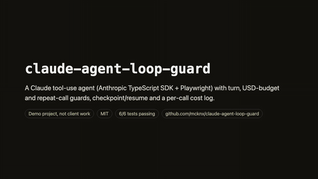
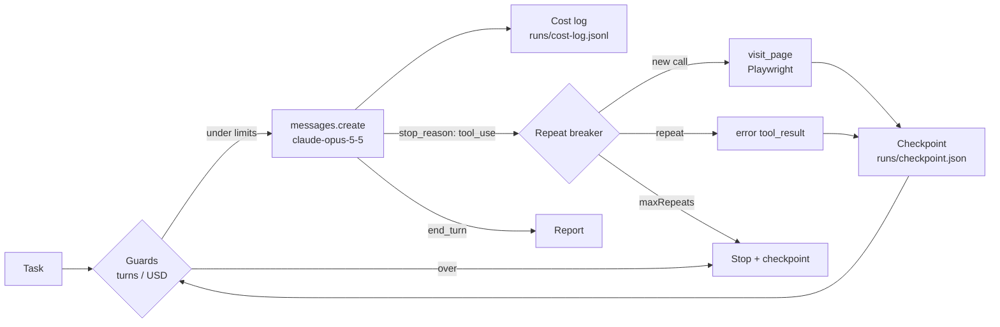

# claude-agent-loop-guard

[](https://github.com/mcknx/claude-agent-loop-guard/actions/workflows/ci.yml)

## Watch the 60-second demo

[](docs/demo.mp4)

[Watch the full demo (MP4, 59 s)](docs/demo.mp4): the README, the architecture diagram, the turn/USD guards and the repeat breaker in `src/agent.ts`, the 6 tests passing and an `npm start` run. No audio; captions on screen.

> **Demo project, not client work.** Guard rails around a Claude tool-use agent loop. The shop it browses is a fictional local fixture. No `ANTHROPIC_API_KEY` was used to produce the output below: the loop ran against a **scripted fake model client**, and the browser part is real Playwright.

## What it does (30 seconds)

A Claude tool-use agent (Anthropic TypeScript SDK, `claude-opus-5-5`) opens a small shop website with **Playwright**, visits each product page and returns a comparison table. Around that loop sit the guards that keep an agent from burning money:

| Guard | What trips it | What happens |
|---|---|---|
| Max turns | `turns >= maxTurns` | stops **before** paying for the next call |
| USD budget | `spent >= maxUsd` (priced from `usage` on every response) | stops before the next call |
| Repeat breaker | same tool + same arguments again (key order ignored) | 2nd time: the tool is **not** re-run, the model gets an error result telling it to move on. At `maxRepeats`: hard stop |
| Checkpoint / resume | written after every turn | a stopped or crashed run continues from the file, no page fetched twice |
| Cost log | every model call | one JSON line: tokens in/out, call cost, running total |

**"How do you stop an agent from getting stuck in a loop and wasting API costs?"** Count identical tool calls with a canonical key, answer the first repeat with a cheap error instead of running the tool again (a chance to change course), stop hard at a small threshold, and check the turn and dollar ceilings *before* each request rather than after. Then checkpoint so a stop costs nothing to resume.

## Architecture



| File | Lines | Job |
|---|---|---|
| `src/agent.ts` | ~125 | the loop and every guard |
| `src/browser-tools.ts` | ~30 | `visit_page` tool (Playwright), refuses paths outside the site folder |
| `src/fake-model.ts` | ~55 | scripted stand-in for the SDK client, used by tests and when no key is set |
| `src/cli.ts` | ~30 | runs the demo task |
| `test/agent.test.ts` | ~105 | one test per guard + a real-browser happy path |

## Run it

```bash
npm install
npx playwright install chromium-headless-shell
npm test          # offline, no API key needed
npm start         # demo run; uses the live API only if ANTHROPIC_API_KEY is set
```

Copy `.env.example` to `.env` (or export the variable) to run against the real API.

## Real test output

```
✔ happy path: real Playwright over the fixture site, scripted model (8010.167792ms)
✔ max turns guard stops a model that never finishes (62.328791ms)
✔ USD budget guard stops before the next call once spend hits the ceiling (150.963667ms)
✔ repeat breaker: soft warning on the 2nd identical call, hard stop on the 3rd (18.842416ms)
✔ checkpoint/resume: a stopped run continues where it left off without redoing work (75.48625ms)
✔ cost log: one JSON line per model call, totals match the result (12.840583ms)
ℹ tests 6
ℹ pass 6
ℹ fail 0
```

`npm start` without a key:

```
Model: scripted fake (no ANTHROPIC_API_KEY set)

stop=done turns=3 usd=$0.0240

| Product | Price | Weight | Rating |
|---|---|---|---|
| Summit 40 | $129.00 | 1.4 kg | 4.8 |
| Ridge 35 | $89.00 | 1.1 kg | 4.6 |
| Daylite 20 | $49.00 | 0.6 kg | 4.1 |

Best value: Ridge 35 (4.6 rating at $89).
```

`runs/cost-log.jsonl` from that run:

```
{"turn":1,"in":1000,"out":200,"usd":0.008,"totalUsd":0.008,"stop":"tool_use"}
{"turn":2,"in":1000,"out":200,"usd":0.008,"totalUsd":0.016,"stop":"tool_use"}
{"turn":3,"in":1000,"out":200,"usd":0.008,"totalUsd":0.024,"stop":"end_turn"}
```

## Choices and limits

- **Manual loop on the Anthropic SDK, not the Claude Agent SDK.** The Agent SDK is the Claude Code harness with built-in file/bash tools; for a custom-tool agent that owns every guard, the plain Messages API loop is smaller and easier to test.
- Prices are hard-coded for `claude-opus-5-5` ($4 / $20 per 1M tokens). Change `PRICE` in `src/agent.ts` for another model.
- The budget is checked between calls, so one call can overshoot it. A per-call ceiling would need `max_tokens` sized from the remaining budget.
- Token counts in the fake model are fixed numbers, not real usage.
- Refusals and `max_tokens` stops end the run; there is no model fallback.

## License

MIT
